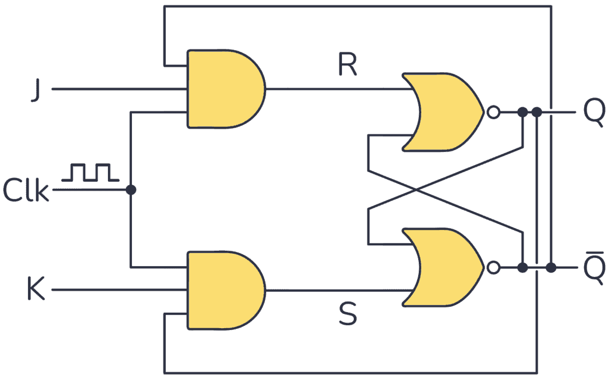

# SR Latch
- Cannonically its the first latch
    - 2 NOR (NAND implementable but then you do !S !R)
        - !(S|Q)=!Q
        - !(R|!Q)=Q
    - sequential, depends on previous value of q
        - HAS A RACE CONDITION (S, R = 1)
        - READING FROM WHO SET 1 FIRST...
            - if S is set first, then read the top operation first
            - if R is set first, then read the 2nd operation first...
    - assume Q initialized to 0

|Q|!Q|S|R|first           |calc       |second          |calc       |Q2|!Q2|Action                     |
|-|--|-|-|---             |---------  |---             |---------  |--|---|---------------------------|
|0|1 |0|0|!(S or Q)=!Q    |!(0 or 0)=1|!(R or !Q)=Q    |!(0 or 1)=0|0 |1  |HOLD                       |
|0|1 |1|0|!(S or Q)=!Q    |!(1 or 0)=0|!(R or !Q)=Q    |!(0 or 0)=1|1 |0  |SET                        |
|1|0 |0|0|!(S or Q)=!Q    |!(0 or 1)=0|!(R or !Q)=Q    |!(0 or 0)=1|1 |0  |HOLD                       |
|1|0 |0|1|**!(R or !Q)=Q**|!(1 or 1)=0|**!(S or Q)=!Q**|!(0 or 0)=1|0 |1  |RESET                      |
|0|1 |0|0|!(S or Q)=!Q    |!(0 or 0)=1|!(R or !Q)=Q    |!(0 or 1)=0|0 |1  |HOLD                       |
|0|1 |1|1|!(S or Q)=!Q    |!(1 or 0)=0|!(R or !Q)=Q    |!(1 or 0)=0|0 |0  |INVALID, CONTRADICTION     |

-  if clk enabled:
-      S NOR q = !q
-      R NOR !q = q
-  else: q

